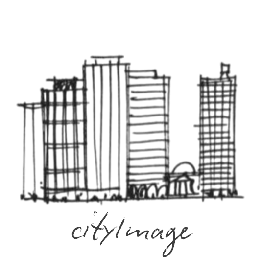
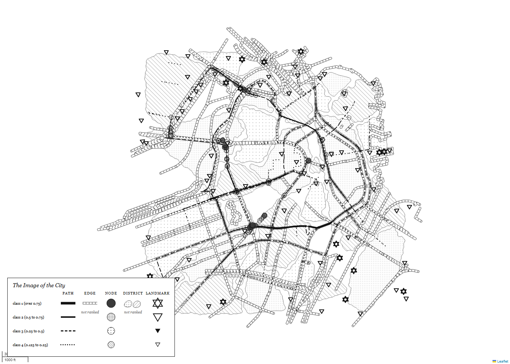

[](https://github.com/g-filomena/cityImage/actions)
[](https://badge.fury.io/py/cityImage)
[](https://cityimage.readthedocs.io/en/latest/?badge=latest)
[](https://codecov.io/gh/g-filomena/cityImage)



# cityImage



*Boston, 1.5 km around the Common, the area of Lynch's own study: paths, edges, nodes, districts
and landmarks from one call to `image_of_the_city`, drawn by `img.explore()` with the symbols of
Lynch's legend. More in the [gallery](https://cityimage.readthedocs.io/en/latest/gallery.html).*

**cityImage** is a Python package for analysing urban legibility and extracting a
computational version of Kevin Lynch's *Image of the City* from geospatial data.

The package works with user-provided GeoPandas datasets and with OpenStreetMap
data acquired through OSMnx. cityImage defines the schema, topology, barrier,
district, landmark, and scoring semantics, and leaves generic acquisition,
spatial joins, plotting, graph algorithms, and raster operations to established
libraries.

For full documentation and examples, see the
[cityImage documentation](https://cityimage.readthedocs.io/en/latest/).

## What cityImage does

From a street network, buildings and barriers, cityImage derives Lynch's five elements:

- **paths**: the streets, scored by angular betweenness on the dual graph;
- **nodes**: the junctions, scored by betweenness centrality;
- **edges**: the barriers that structure movement, such as water, railways, large parks and
  major roads;
- **districts**: partitions of the street network, with the junctions that are their gateways;
- **landmarks**: the buildings, scored on their structural, visual, cultural and pragmatic
  salience.

## What it leaves to other libraries

- GeoPandas and Shapely: geometries, CRS, spatial joins and file IO;
- OSMnx: OpenStreetMap downloads;
- NetworkX and igraph: graphs and their algorithms, the modularity partitions among them;
- rasterio and rasterstats: raster sampling (extra `height`);
- Dask: the parallel 3D sight lines (extra `visibility3d`).

cityImage keeps what is specific to the Image of the City: the schemas of nodes, edges and
buildings, the same at every step; the cleaning of street networks without artificial nodes;
the dual graph and the angles between streets; barriers as Lynch's edges; districts and their
gateways; the landmark scores and the Lynch classes. OSMnx can download a walk network and
NetworkX can compute its betweenness; cityImage turns them into paths, nodes, edges, districts
and landmarks that share the same identifiers.

## Background

The methods are based on:

Filomena, G., Verstegen, J. A., & Manley, E. (2019).
[A computational approach to The Image of the City](https://doi.org/10.1016/j.cities.2019.01.006).
*Cities*, 89, 14–25.

## Installation

Core install:

```bash
pip install cityImage
```

The core install includes graph centrality (igraph) and region detection
(NetworkX), and keeps only heavier, workflow-specific dependencies out of the
base environment. Use extras for those:

```bash
pip install "cityImage[plot]"         # plotting helpers (matplotlib, mapclassify)
pip install "cityImage[height]"       # DEM/DTM height helpers
pip install "cityImage[visibility3d]" # 3D sight-line workflow (adds dask + psutil)
pip install "cityImage[interactive]"  # interactive web maps (folium)
pip install "cityImage[all]"          # all optional runtime dependencies
```

For development:

```bash
pip install -e ".[all,test,docs,dev]"
```

## Main API areas

Submodules marked *(extra: X)* need the corresponding optional install (see
[Installation](#installation)); the rest are available with the core install.

- `cityImage.schema` and `cityImage.adapters`: stable node/edge/building schemas,
  validation, and input standardisation.
- `cityImage.io`: file/GeoPandas loading into cityImage schemas.
- `cityImage.osm`: OSMnx acquisition into cityImage schemas.
- `cityImage.network` and `cityImage.network_topology`: street-network
  construction, cleaning, simplification, and topology repair. See the
  [network cleaning guide](https://github.com/g-filomena/cityImage/blob/master/docs/network_topology.md)
  for every case, with diagrams.
- `cityImage.graph` and `cityImage.angles`: primal/dual graph semantics and
  angular relationships. Each dual edge records whether the move between two
  segments is allowed both ways or one way (`oneway`), and
  `dual_graph_fromGDF` keeps it, with the edge's `u` and `v`, on each edge.
- `cityImage.centrality`: node/edge centrality wrappers (iGraph-based measures;
  iGraph is a core dependency). `append_edges_metrics` takes edge measures
  computed on a `Graph` (`graph_fromGDF`) or a `MultiGraph` (`multiGraph_fromGDF`).
- `cityImage.barriers`: natural and artificial barriers such as rivers,
  railways, parks, and major roads.
- `cityImage.regions`: districts and gateways from network partitions
  (Louvain modularity partitions, with NetworkX).
- `cityImage.landuse`: land-use derivation, classification, sparse
  representation, and assignment.
- `cityImage.buildings`: building selection, study-area and height-reading helpers.
- `cityImage.height`: DEM/DTM-based building heights. *(extra: height)*
- `cityImage.landmarks` and `cityImage.scoring`: Lynchian landmark and
  imageability scoring. A building without a height has no visual score (NaN), which adds
  nothing to its landmark score.
- `cityImage.visibility2d`: 2D visibility workflows.
- `cityImage.visibility3d`: optional 3D sight-line workflows; `verbose=True` logs
  progress through `logging`. *(extra: visibility3d)*
- `cityImage.plotting`: optional static plotting helpers. *(extra: plot)*
- `cityImage.interactive`: interactive web map of the five elements. *(extra: interactive)*
- `cityImage.pipeline`: `image_of_the_city`, the five elements in one call.
- `cityImage.sensitivity`: how much the landmarks depend on the weights of their score.

## Minimal example

One call downloads a place from OpenStreetMap and returns the five elements:

```python
import cityImage as ci

img = ci.image_of_the_city(
    (42.357, -71.064),               # Boston Common
    download_method="distance_from_point",
    distance=1500,
    crs="EPSG:32619",
)

img.paths       # streets, with angular betweenness (Ab) and lynch_class
img.nodes       # street nodes, with betweenness (Bc), lynch_class, district, gateway
img.edges       # barriers: rivers, railways, major roads, parks
img.districts   # district polygons
img.landmarks   # buildings, with their global landmark score (gScore) and lynch_class

img.plot()                 # one map of the five elements (extra: plot)
img.explore()              # interactive web map, one layer per element (extra: interactive)
img.to_file("boston.gpkg")  # one GeoPackage layer per element
```

Every layer keeps all its features with their scores. As in Filomena, Verstegen & Manley
(2019), the scores of nodes, paths and landmarks are rescaled to 0–1 and ranked in Lynch's
ranges (0.125, 0.25, 0.5, 0.75): `lynch_class` is 1 for the strongest elements (over 0.75)
down to 4 (0.125 to 0.25), 0 below, and `img.landmarks[img.landmarks.lynch_class.isin([1, 2])]`
keeps only the strongest landmarks.
Your own layers can replace any download: `ci.image_of_the_city(nodes=..., edges=...,
buildings=..., barriers=...)`. Every step and its parameters are in `CityImageConfig`.
The landmark weights are those of the paper; `ci.landmark_weight_sensitivity(img.landmarks)`
measures how much the landmarks depend on them. The
[Quickstart](https://cityimage.readthedocs.io/en/latest/notebooks/quickstart.html) goes through
all of this.

Step by step, the same data can be downloaded with:

```python
around_common = dict(download_method="distance_from_point", distance=1500, crs="EPSG:32619")

nodes, edges = ci.network_from_osm((42.357, -71.064), network_type="walk", **around_common)
buildings = ci.buildings_from_osm((42.357, -71.064), **around_common)
barriers = ci.barriers_from_osm((42.357, -71.064), **around_common)
```

OSM `height` tags cover only some buildings, so `buildings_from_osm` leaves them
out unless `keep_osm_heights=True`. `buildings_from_file` reads heights from
`height_field` and drops buildings lower than `min_height`; a building without a
height (missing, unreadable or not above zero) is kept with a NaN height. Heights
are yours to supply: in the scores a building without one has no visual score
(it adds nothing to the landmark score), and it is neither a target nor an
obstruction in the 3D sight lines.

## Development checks

```bash
ruff check cityImage tests scripts
ruff format --check cityImage tests scripts
mypy
pytest -m "not network" -ra
python -m build
twine check dist/*
```

## Changelog

See [CHANGELOG.md](https://github.com/g-filomena/cityImage/blob/master/CHANGELOG.md).

## License

cityImage is distributed under the GNU General Public License v3.0 or later.
