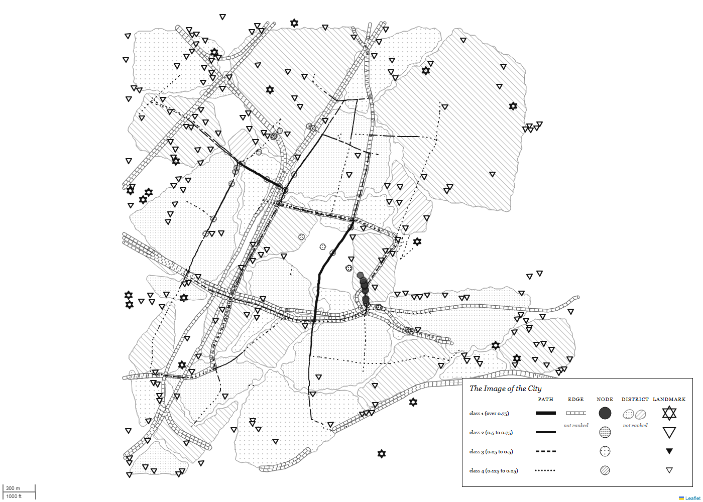
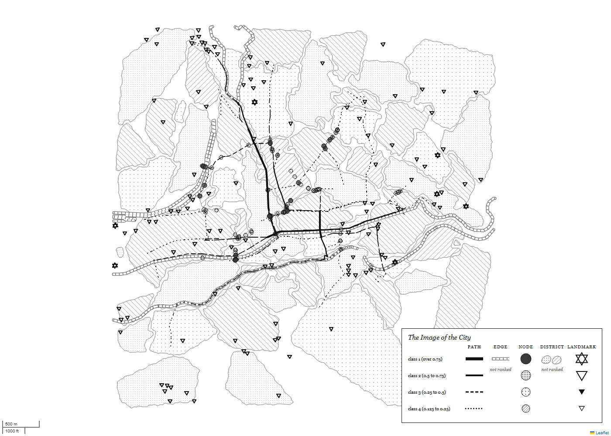
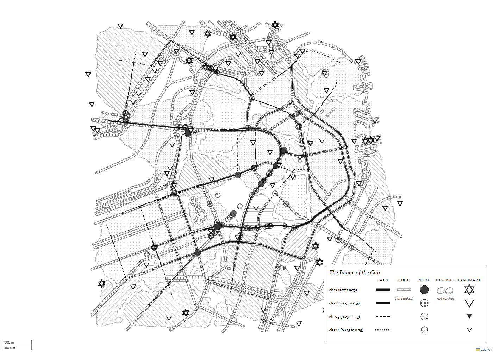

# Gallery

The computational Image of the City of a few cities, each from one call to
`image_of_the_city` and drawn by `explore()` with the symbols of Lynch's legend. Paths of all
classes, nodes and landmarks of classes 1–2, edges and districts; the interactive maps hold every
class as a layer of its own. All data © OpenStreetMap contributors.

## Freiburg im Breisgau

2 km around the Münster. The railways, major roads and the Dreisam are the edges; the
strongest paths are the Stefan-Meier-Straße and the Kaiser-Joseph-Straße, the main street of the
old town, then the Breisacher Straße and the Eschholzstraße.

```python
img = ci.image_of_the_city(
    "Münsterplatz, Freiburg im Breisgau, Germany",
    download_method="distance_from_address",
    distance=2000,
    crs="EPSG:32632",
)
img.explore()
```



## Sarajevo

2.5 km around the centre, in the valley of the Miljacka. Čobanija, Alipašina and Kulovića are the
strongest paths, with Obala Kulina bana along the river.

```python
img = ci.image_of_the_city(
    (43.858, 18.418),
    download_method="distance_from_point",
    distance=2500,
    crs="EPSG:32634",
)
img.explore()
```



## Boston

1.5 km around Boston Common, the area of Lynch's own study (*The Image of the City*, 1960,
chapter 2). The John F. Fitzgerald Surface Road, along the Rose Kennedy Greenway, and Purchase
Street are the strongest paths, then Essex Street. The edges are crowded: OpenStreetMap tags many
of Boston's streets as major roads, and their 60 km of barriers outweigh the 17 km along the
water, where Lynch's interviewees saw above all the Charles River.
`CityImageConfig(include_primary_barriers=False)` keeps only the motorways and trunk roads.

```python
img = ci.image_of_the_city(
    (42.357, -71.064),
    download_method="distance_from_point",
    distance=1500,
    crs="EPSG:32619",
)
img.explore()
```


