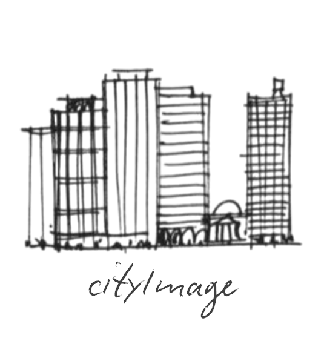

cityImage's documentation
=========================

Introduction
------------

``cityImage`` is a Python package for extracting a computational representation
of Lynch's *Image of the City* from geospatial data. It works with user-provided
GeoPandas datasets and with OpenStreetMap data acquired through OSMnx, while
preserving a cityImage-specific schema for networks, buildings, barriers,
districts, landmarks, and imageability scores.

Theoretical considerations
--------------------------

The *Image of the City* is a community mental representation of a city resulting
from the overlap of people's individual images of urban space. The term overlaps
with related notions such as cognitive maps, mental images, and image schemata.

Lynch identified five urban elements commonly shared across citizens and
visitors: paths, nodes, edges, districts, and landmarks. Whereas Lynch's original
work relied on qualitative interviews, ``cityImage`` supports a computational
formulation based on geospatial data.

For the original computational formulation, see: Filomena, G., Verstegen, J. A.,
& Manley, E. (2019). `A computational approach to The Image of the City. Cities,
89, 14–25 <https://doi.org/10.1016/j.cities.2019.01.006>`_.

Installation
------------

Core install:

.. code-block:: bash

   pip install cityImage

Install with all optional extras:

.. code-block:: bash

   pip install "cityImage[all]"

Main API areas
--------------

Submodules marked *(extra: X)* need the corresponding optional install (see
Installation above); the rest are available with the core install.

- ``cityImage.schema`` and ``cityImage.adapters``: stable node/edge/building
  schemas, validation, and input standardisation.
- ``cityImage.io``: file/GeoPandas loading into cityImage schemas.
- ``cityImage.osm``: OSMnx acquisition into cityImage schemas.
- ``cityImage.network`` and ``cityImage.network_topology``: street-network
  construction, cleaning, simplification, and topology repair.
- ``cityImage.graph`` and ``cityImage.angles``: primal/dual graph semantics and
  angular relationships.
- ``cityImage.centrality``: node/edge centrality wrappers (iGraph-based measures;
  iGraph is a core dependency).
- ``cityImage.barriers``: natural and artificial barriers such as rivers,
  railways, parks, and major roads.
- ``cityImage.regions``: districts and gateways from network partitions
  (Louvain modularity partitions, with NetworkX).
- ``cityImage.landuse``: land-use derivation, classification, sparse
  representation, and assignment.
- ``cityImage.buildings``: building selection and study-area helpers.
- ``cityImage.height``: DEM/DTM-based building heights. *(extra: height)*
- ``cityImage.landmarks`` and ``cityImage.scoring``: Lynchian landmark and
  imageability scoring.
- ``cityImage.visibility2d``: 2D visibility workflows.
- ``cityImage.visibility3d``: optional 3D sight-line workflows. *(extra: visibility3d)*
- ``cityImage.plotting``: optional static plotting helpers. *(extra: plot)*
- ``cityImage.interactive``: interactive web map of the five elements. *(extra: interactive)*
- ``cityImage.pipeline``: ``image_of_the_city``, the five elements in one call.
- ``cityImage.sensitivity``: how much the landmarks depend on the weights of their score.

Typical use
-----------

One call downloads a place from OpenStreetMap and returns the five elements:

.. code-block:: python

   import cityImage as ci

   img = ci.image_of_the_city(
       (42.357, -71.064),               # Boston Common
       download_method="distance_from_point",
       distance=1500,
       crs="EPSG:32619",
   )
   img.paths, img.nodes, img.edges, img.districts, img.landmarks  # GeoDataFrames
   img.plot()                 # one map of the five elements (extra: plot)
   img.explore()              # interactive web map (extra: interactive)
   img.to_file("boston.gpkg")  # one GeoPackage layer per element

As in Filomena, Verstegen & Manley (2019), the scores of nodes, paths and
landmarks are rescaled to 0–1 and ranked in Lynch's ranges (0.125, 0.25, 0.5,
0.75) in ``lynch_class``: 1 for the strongest (over 0.75) down to 4, 0 below.
Every step and its parameters are in ``CityImageConfig``. The Quickstart and the
Gallery show the results; the User Guide goes through each step. The same data
can be downloaded step by step with:

.. code-block:: python

   around_common = dict(download_method="distance_from_point", distance=1500, crs="EPSG:32619")

   nodes, edges = ci.network_from_osm((42.357, -71.064), network_type="walk", **around_common)
   buildings = ci.buildings_from_osm((42.357, -71.064), **around_common)
   barriers = ci.barriers_from_osm((42.357, -71.064), **around_common)

Documentation content
---------------------

.. toctree::
   :maxdepth: 1

   Home <self>
   About <about>
   User Guide <notebooks/userGuide.rst>
   Gallery <gallery>
   Network cleaning <network_topology>
   API reference <api>
   Changelog <changelog>

.. toctree::
   :maxdepth: 1
   :caption: Developer guide

   Module ownership <development/module_ownership>
