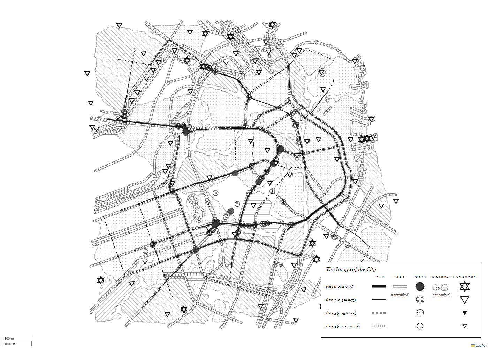

# Quickstart

From a place name to the five elements of Kevin Lynch's *Image of the City* (paths, nodes,
edges, districts, landmarks) in one call, following Filomena, Verstegen & Manley (2019).

## Install

```bash
pip install "cityImage[plot,interactive]"
```

`plot` adds the static map (matplotlib), `interactive` the web map (folium).

## One call

```python
import cityImage as ci

img = ci.image_of_the_city(
    (42.357, -71.064),               # Boston Common
    download_method="distance_from_point",
    distance=1500,
    crs="EPSG:32619",
)
```

`image_of_the_city` downloads from OpenStreetMap the walkable street network, the drive network
(for the districts), the buildings and the barriers, cleans the network and computes:

| Element | Layer | Method | Columns |
|---|---|---|---|
| Paths | `img.paths` (streets) | angular betweenness on the dual graph | `Ab`, `Ab_sc`, `lynch_class`, `sep_barr` |
| Nodes | `img.nodes` (junctions) | betweenness weighted by length | `Bc`, `Bc_sc`, `lynch_class`, `district`, `gateway` |
| Edges | `img.edges` (barriers) | rivers, railways, major roads, parks | `barrier_type`, `barrierID` |
| Districts | `img.districts` (polygons) | modularity on the dual drive network, weighted by angle | `district` |
| Landmarks | `img.landmarks` (buildings) | global landmark score | `gScore`, `gScore_sc`, `lynch_class`, its components |

A city of 2 km around its centre takes 10–30 minutes, most of it spent waiting for
OpenStreetMap's Overpass servers.

## Lynch classes

Lynch ranked the elements of his maps by how many interviewees mentioned them. As in the 2019
paper, the scores of paths, nodes and landmarks are rescaled to 0–1 over the study area and
ranked in the same ranges:

| `lynch_class` | Rescaled score | Lynch's frequency |
|---|---|---|
| 1 | over 0.75 | over 75% |
| 2 | 0.5 to 0.75 | 50–75% |
| 3 | 0.25 to 0.5 | 25–50% |
| 4 | 0.125 to 0.25 | 12.5–25% |
| 0 | below 0.125 | not on the map |

Every feature is kept with its score; the class only says how strong it is:

```python
strongest = img.landmarks[img.landmarks.lynch_class.isin([1, 2])]
```

Edges and districts are not ranked. The ranges are `CityImageConfig(lynch_bins=...)`.

## Maps

```python
m = img.explore()       # interactive, needs the interactive extra
m.save("boston.html")
img.plot()              # static, needs the plot extra
```

`explore()` draws the elements with the symbols of Lynch's legend, black on white, a layer for
each class of paths, nodes and landmarks:



More cities are in the [gallery](../gallery.md).

## Your own data

Any layer can replace its download; the rest is downloaded for `place` as before:

```python
img = ci.image_of_the_city(
    nodes=nodes, edges=edges,          # a street network, e.g. from ci.network_from_file
    buildings=buildings,               # footprints, with a height column if you have one
    barriers=barriers,
    elements=("paths", "nodes", "edges", "landmarks"),  # leave out what you do not need
)
```

Without a place, the districts are computed on the given network
(`CityImageConfig(district_network="same")`). Buildings without a `height` column have no visual
component (3D visibility, facade, height): the landmark score then rests on the structural,
cultural and pragmatic components, and a warning says so. OpenStreetMap rarely has heights;
cityImage does not guess them. The cultural component reads OSM's `historic` tag, where the
buildings have one; for other sources of cultural value, score the buildings step by step (see
the [landmarks notebooks](Landmarks_Local_Files.ipynb)).

## Configuration

Every parameter of every step is in `CityImageConfig`:

```python
config = ci.CityImageConfig(
    network_type="walk",              # network of paths and nodes
    district_network="drive",         # or "same": the paths network
    min_district_size=10,             # smaller partitions are dropped
    buildings_min_area=200,           # m², smaller buildings are not candidates
    landmark_scoring=ci.LandmarkScoringConfig(
        global_component_weights={"vScore": 0.5, "sScore": 0.3, "cScore": 0.1, "pScore": 0.1},
    ),
)
img = ci.image_of_the_city(
    (42.357, -71.064), download_method="distance_from_point", distance=1500, crs="EPSG:32619",
    config=config,
)
img.metadata                 # place, CRS, networks, cityImage version, date
img.to_file("boston.gpkg")   # one GeoPackage layer per element
```

## How much do the landmarks depend on the weights?

The default weights are those of the paper (Table 1). `landmark_weight_sensitivity` perturbs
them, recomputes the score and compares it with the original:

```python
runs = ci.landmark_weight_sensitivity(img.landmarks, perturbation=0.2, n_samples=200)
runs[["spearman", "top_k_overlap", "same_class", "strong_kept"]].describe()

# one weight at a time, 20% down and up
oat = ci.landmark_weight_sensitivity(img.landmarks, method="one_at_a_time")
oat.groupby("varied")[["spearman", "strong_kept"]].min()
```

In Boston (1,774 buildings, no heights), with every weight changed at random by up to 20%:

| | mean | min |
|---|---|---|
| rank correlation with the original score (`spearman`) | 0.997 | 0.986 |
| top 20 buildings still in the top 20 (`top_k_overlap`) | 0.92 | 0.80 |
| buildings in the same Lynch class (`same_class`) | 0.93 | 0.78 |
| class 1–2 buildings still in class 1–2 (`strong_kept`) | 0.93 | 0.68 |

The ranking hardly moves; the membership of the few strongest buildings (15 in class 1) is
more fragile, chiefly to the weights of the structural and pragmatic components and of the
building area.

## Step by step

The User Guide notebooks go through each step with its own functions and parameters: networks,
districts, barriers, landmarks, from OpenStreetMap or from local files.
